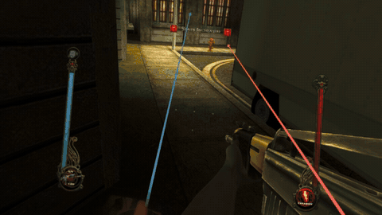
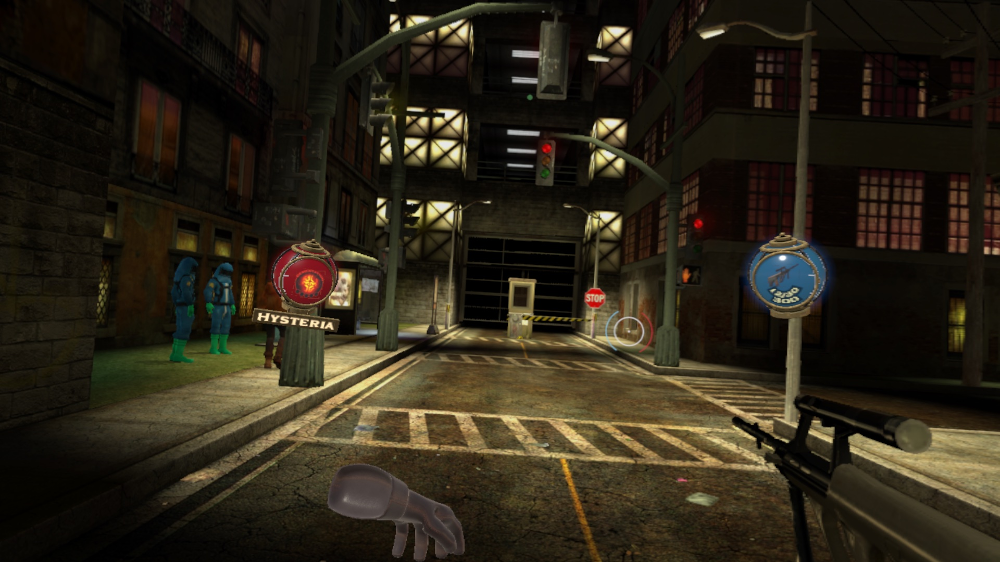
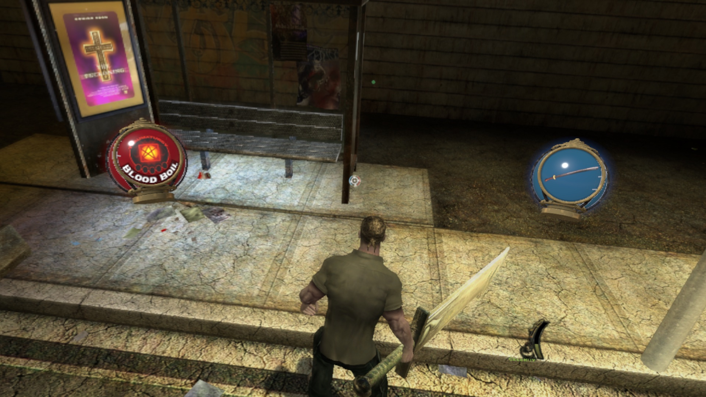

# Embrace

**The night of Los Angeles, all around you on Apple Vision Pro.**

 

 

## What it is

Embrace is a native visionOS port of Vampire: The Masquerade, Bloodlines
(Troika Games, 2004), built by A. Cervantez as a portfolio piece. The game
runs natively on the headset's Apple silicon and draws through a Metal
renderer written for this port, in true stereo, with your head as the
camera.

## Features

- **Full-view 6DoF stereo.** Each eye gets its own render of the world
  from its own position, filling the whole field of view. Your head is the
  camera: look around, lean, and the city moves as it should.
- **Native Metal renderer.** The game's Direct3D 9 calls go straight to a
  Metal backend made for this port, with no Vulkan layer underneath. Its
  shaders are translated to Metal Shading Language and cached on device.
- **Hand-aimed weapons.** Guns follow the controller in your hand and
  tilt with your wrist. The reticle sits where the shot will land, opens
  and closes with the weapon's spread, and carries health and blood as
  arcs around it.
- **A reticle that matches the game's aim.** In third person the reticle
  sits on the game's own aim point, so it follows walls, fences and
  characters exactly as the game's own crosshair does.
- **PlayStation VR2 Sense controllers, tracked.** Both halves are tracked
  in the room. In menus, point a controller to move the cursor.
- **Caged orbs for health and blood.** The flat side gauges are replaced
  by two glass orbs in iron and brass cages, drawn in real 3D for each
  eye. Health rides by your gun hand with the weapon and its ammo count;
  blood rides by the other hand with the selected power's icon and its
  name on a brass nameplate. The liquid falls as you spend it and sloshes
  as you move. In third person the orbs hold their place beside you.
- **An in-game layout editor.** Hold both thumbsticks to pick up the
  orbs, the gloves and the reticle and place them by hand, or with a
  gizmo's move arrows, rotation rings and scale handle. Layouts are saved
  on the headset.
- **Gloved hands.** Optional leather gloves of the project's own design
  follow the controllers, with fingers that answer the trigger and grip.
  While a gun is out, the gun hand's glove steps aside so the weapon
  stands on its own.
- **A comfortable held camera.** In dialogue and in third person the view
  holds steady around you, so close-ups and chase views never swing with
  your head.
- **Effects that work in stereo.** Disciplines such as Presence and
  Celerity render correctly in each eye.

## No game data included

This repository and every build made from it contain no game data: no
maps, models, textures, sounds, scripts or executables. To play, you need
your own legally obtained, installed copy of the game. The build refuses
to package an app that carries game files.

## Build and install

See [AVP-INSTALL.md](AVP-INSTALL.md) for requirements, building from a
checkout, installing on Apple Vision Pro, and where your game files go.

## Credits

Embrace builds on these open-source projects:

- [Bloodlines Porter](https://github.com/OlehPetrykUA/bloodlines-porter)
  (MIT), the native runtime and build toolchain the port is built on,
  with its recompiler from xboxrecomp by sp00nz (MIT)
- [DXVK](https://github.com/doitsujin/dxvk) (Zlib), its D3D9 shader front end, built
  from the [jm2 fork](https://github.com/jm2/dxvk),
  with [dxbc-spirv](https://github.com/doitsujin/dxbc-spirv) (MIT) and
  [libdisplay-info](https://gitlab.freedesktop.org/emersion/libdisplay-info) (MIT)
- [SPIRV-Cross](https://github.com/KhronosGroup/SPIRV-Cross) (Apache-2.0)
- [SDL](https://github.com/libsdl-org/SDL) (Zlib)
- [FFmpeg](https://github.com/FFmpeg/FFmpeg) (LGPL-2.1-or-later), for the
  game's movies

## Licence

MIT. See [LICENSE](LICENSE). Copyright (c) 2026 A. Cervantez.
